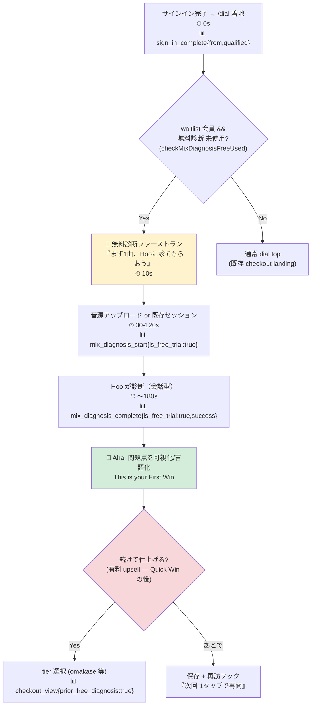

# MUEDial アクティベーション オンボーディング設計 (draft)

**Status:** draft / 着手前 (コード実装は CI billing block 6/1 復帰後)
**Author:** mued課
**Date:** 2026-05-31
**関連:** [dial-funnel-instrumentation-design.md](./dial-funnel-instrumentation-design.md) (計測設計, PR #411), [dial-funnel-fixes.md](./dial-funnel-fixes.md) (sprint#001), `.claude/skills/mued-onboarding/SKILL.md` (フレームワーク)

---

## なぜこの設計か

[funnel計測設計 (PR #411)](./dial-funnel-instrumentation-design.md) で **Gap B = mix_diagnosis アクティベーションが最重要かつ完全に未計測** と確定した。本ドラフトはその裏返し — **「アクティベーションが測れない」だけでなく「アクティベーションへ導く導線自体が存在しない」** という product gap を、`mued-onboarding` スキルのフレームワークで埋める設計。

計測設計（何を測るか）と本設計（何を作るか）で **アクティベーション spec が完結**する。

---

## 検証で判明した product gap（コード実態）

| 確認項目 | 実態 | 含意 |
|---------|------|------|
| `app/dial` / `components/dial` の first-run / empty-state / onboarding コード | **grep 0 件** | サインイン後の初回導線が存在しない |
| `/dial` top の初期状態 | `mixType` 初期値 = `'omakase'`（**有料 $7.49**, `app/dial/page.tsx:307`）。email + tier 選択の **checkout 指向 landing** | 初回ユーザーが**いきなり有料 tier 選択**に着地 |
| セッション開始後 | `dial_session_id` を localStorage 保存 → `/dial/session/{id}` へ（`page.tsx:343,601-603`） | 無料 mix_diagnosis への誘導ステップなし |
| waitlist 会員の無料診断 | `mix_diagnosis` lifetime 1回 free（`lib/storage/mix-diagnosis-free.ts`, consume route `:176`） | **無料の「First Win」が landing で前面化されていない** |

### 中核問題: 支払いゲートが Quick Win より前にある

`mued-onboarding` フレームワークの Phase 順は **Phase 2 Quick Win → Phase 4 Registration/Payment Gate**。現状の `/dial` はこれを逆転させ、**Aha Moment 体験前に有料 tier 選択（omakase default）を提示**している。waitlist で「無料診断」を約束されて来たユーザーにとって、約束された無料の First Win が導線の主役になっていない = アクティベーション漏れ。

---

## Aha Moment 定義（現行 MUEDial 版・skill 定義の更新）

> skill の「AI Mixing/Mastering（mued.jp）」定義（`1ファイルアップロード + プレビュー再生` / TTV 180s）は**旧・汎用ミキシングフロー**前提。現行 MUEDial は **Hoo ディレクター × 会話型診断**であり、Aha Moment を更新する。

| 項目 | 現行 MUEDial 定義 |
|------|------------------|
| **Aha Moment** | 「Hoo が自分のミックスの問題点を診断して、具体的に見せ／言語化してくれた」瞬間（mix_diagnosis 結果） |
| **Activation Metric** | 初回セッションで **mix_diagnosis を 1 回完了**（`mix_diagnosis_complete`） |
| **Target TTV** | 初回サインイン着地から **180 秒以内**（アップロード待ち含む） |
| **無料→有料転換目標** | 無料診断完了者の **30% 以上**が同セッション内で有料 tier（omakase 等）へ |
| **ディレクターモデル整合** | Aha = 「機材を触れた」ではなく「**ディレクター(Hoo)に見てもらえた**」体験 — Hoo の判断能力こそ差別化資産（CLAUDE.md ディレクターモデル参照） |

---

## 提案フロー（Mode 2: Mermaid）



**設計の肝:** 有料ゲート（G/H）を **Aha Moment（F）の後ろ**に移す。無料診断を first-run の主役にし、Quick Win を体験させてから課金導線を出す（Value Before Payment）。

---

## Phase 別チェック（skill フレームワーク適用・優先順）

| Phase | 現状 | 提案 | 優先 |
|-------|------|------|------|
| **P1 First Contact** (0-15s) | 有料 tier landing | 「無料でまず診断」を 3 秒で伝える first-run カード | ★★★ |
| **P2 Quick Win** (15-180s) | なし | 無料 mix_diagnosis をガイド付きで完了させる | ★★★ |
| **P4 Payment Gate** | landing 冒頭（早すぎ） | Aha 後ろに移動。`prior_free_diagnosis` 付き | ★★★ |
| **P5 Habit Loop** | session localStorage のみ | 「次回 1タップ再開」+ 結果保存の明示 | ★★ |
| **P3 Personalization** | readiness で部分取得済 | ジャンル/目的を診断結果に反映（既存 MUSICAL_STYLE_MAP 活用） | ★ |
| **P6 Re-engagement** | なし | Day1 再訪（無料診断の続き／2曲目） | ★（後続） |

---

## 計測ワイヤリング（PR #411 と接続）

本設計のフローは [#411 の提案 event](./dial-funnel-instrumentation-design.md) でそのまま測れる。アクティベーション ファネル:

```
sign_in_complete
  → mix_diagnosis_start{is_free_trial:true}   （目標: 60%以上 — first-run 主役化の効果）
    → mix_diagnosis_complete{is_free_trial:true} （目標: 75%以上 — 診断完走率）
      → checkout_view{prior_free_diagnosis:true}  （目標: 30%以上 — 無料→有料）
```

KPI（skill テンプレート準拠）:
- **Activation Rate** = `mix_diagnosis_complete / sign_in_complete` — 目標 45%以上
- **TTV** = `mix_diagnosis_complete.ts − sign_in_complete.ts` — 目標 180s以内
- **Free→Paid** = `checkout_view{prior_free_diagnosis} / mix_diagnosis_complete` — 目標 30%以上

---

## 実装シーケンス（CI billing block 制約反映）

| 項目 | 種別 | 6/1 前 |
|------|------|--------|
| 本アクティベーション設計（design） | docs-only (Tier 1) | ✅ 着手可 |
| first-run 分岐の UI 実装（`/dial` landing の waitlist+free 判定→無料診断前面化） | **コード (Tier 2)** | ❌ 6/1 CI 復帰後 |
| 計測 event 実装（#411 Gap A/B/C） | **コード (Tier 2)** | ❌ 6/1 CI 復帰後 |
| Hoo セリフ i18n（first-run カード文言, EN/JA） | コード + i18n | ❌ 6/1 後（設計時に下書き可） |

→ 6/1 復帰後の **コード PR 群**（計測 + first-run 導線）は本設計 + #411 で spec 確定済み。実装は導線分岐 + event 発火の機械的作業に落ちる。

---

## オープン項目（実装時解消）

### ✅ #1 解消（2026-05-31 追検証）: first-run 分岐の client データ取得 = **GET eligibility route を新設**（既存 precedent あり）

コード実態を検証して確定:

- `/dial` landing（`app/dial/page.tsx`）は **`'use client'`**。Clerk client hook（`useAuth().isSignedIn` `:294` / `useUser().user` `:295`）でサインイン状態は持つが、**waitlist 会員 / 無料診断 eligibility は一切 fetch していない**（現状 fetch は `/api/dial/checkout` のみ `:327`）。
- 無料診断 eligibility ロジックは存在するが **POST consume route に埋め込み**: `app/api/dial/credits/consume/route.ts:164` `checkWaitlistEmailExists(email)` + `:171` `checkMixDiagnosisFreeUsed(email)`。**GET の eligibility 公開口は無い**。
- **precedent あり**: `app/api/dial/subscription/status/route.ts` の `GET`（`:17`、PR #375/#377 pricing dual-defense）が「client が server user-state を要る」ケースの確立パターン。

→ **解消設計**: GET `/api/dial/credits/free-status`（仮）を新設。`withDialAuth` でサインインユーザーの email を server 側解決 → `checkWaitlistEmailExists` + `checkMixDiagnosisFreeUsed` を再利用し `{ isWaitlistMember, freeDiagnosisUsed, eligible }` を返す。landing が mount 時に fetch → `eligible` なら mixType=omakase default の代わりに **first-run 無料診断カード**を前面化（本ドラフトのフロー B→C）。

⚠️ **新 API endpoint = Plan Mode 必須**（CLAUDE.md Plan Mode Policy「新しい API エンドポイントを追加する」）。Tier は **Tier 2**（auth/pricing/破壊的schema に非該当、既存 helper を読むだけの純追加 GET）。6/1 着手時に `/plan` 発動 → 設計承認 → 実装。

### 残オープン（実装時解消）

2. first-run カードを `/dial` page に inline で出すか、専用 `/dial/start` route にするか（後者は計測が綺麗だが route 追加 = Tier 2 設計）
3. 「あとで」分岐（P5）の再訪フックを push 不可前提でどう作るか（Web、通知権限なし）
4. ディレクターモデル整合: Hoo の first-run セリフトーン（「ほほう、まず1曲聴かせて」系 — skill 注意書き「オンボーディング中は自然な案内優先」）
